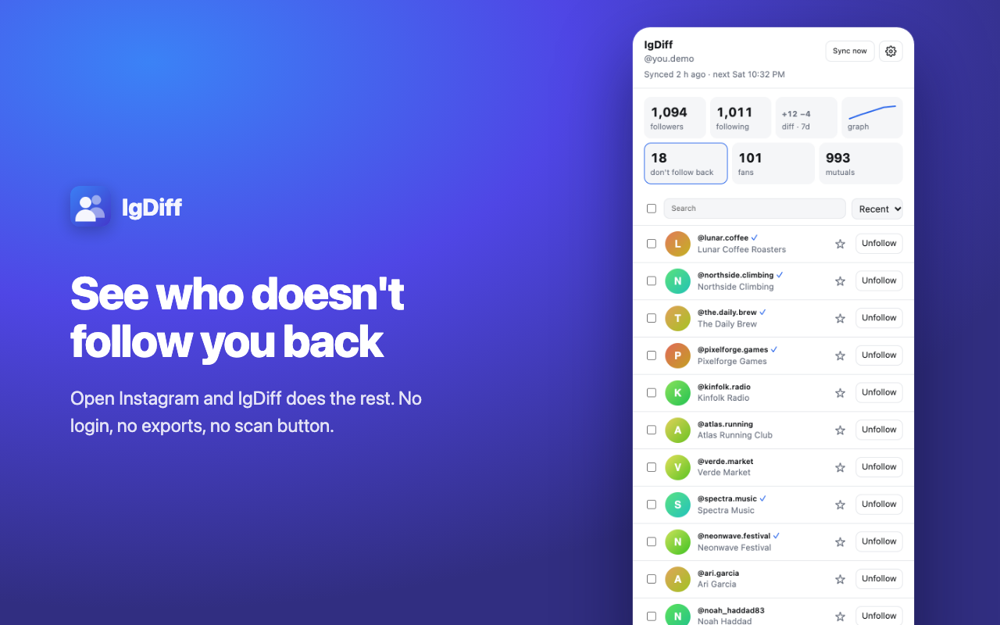

# IgDiff

**See who doesn't follow you back on Instagram, who unfollowed you, and your mutuals. Automatically, and privately.**

[**Add to Chrome →**](https://chromewebstore.google.com/detail/igdiff/nmkbnileakkkaplacmlcmponmpnaihdb)

## How it works

Install IgDiff and open Instagram in a tab where you're already signed in. IgDiff reads your followers and following in the background (about 20 seconds for 1,000 accounts), then takes a snapshot once a day while an Instagram tab is open. Click the toolbar icon for the side panel.

There's no login, no data export, and no scan button.

## What you get

- **Followers and following**, with a 7-day diff and a follower graph
- **Don't follow back**, **fans** (they follow you, you don't follow them) and **mutuals**
- **Changes:** who followed and unfollowed you, day by day. Unfollows are double-checked with Instagram before they show up.
- **Unfollow, remove followers or follow back**, one at a time or in bulk, after one confirmation
- **Keep list:** star accounts you never want unfollowed or removed
- Sort, search, CSV/JSON export, light and dark mode, and a toolbar badge when someone unfollows you

## Private by design

- Your data stays in your browser (IndexedDB). There are no servers, analytics or ads.
- IgDiff talks only to Instagram, from your own signed-in tab, using the session you already have. It never sees your password.
- You can delete everything with one click. [Privacy policy](extension/PRIVACY.md)

## Safe pacing

Unfollows, removals and follow-backs go 15–35 seconds apart, with a 5-minute break every 10 and at most 100 a day. IgDiff stops at the first sign that Instagram objects and waits a day. Nothing ever happens without your confirmation.

## Develop

The extension lives in [`extension/`](extension/). It's built with WXT, Preact and TypeScript, and tested with Vitest against a fake Instagram. See [extension/README.md](extension/README.md) for building, loading and testing.

## Credits and license

IgDiff is a rewrite built on [InstagramUnfollowers](https://github.com/davidarroyo1234/InstagramUnfollowers) by David Arroyo and [Edvin's fork](https://github.com/EdvinCodes/InstagramUnfollowers). Their original web app is still in this repository; see [README.legacy.md](README.legacy.md).

MIT licensed. See [extension/LICENSE](extension/LICENSE).

IgDiff is not affiliated with, endorsed by, or sponsored by Instagram or Meta.
